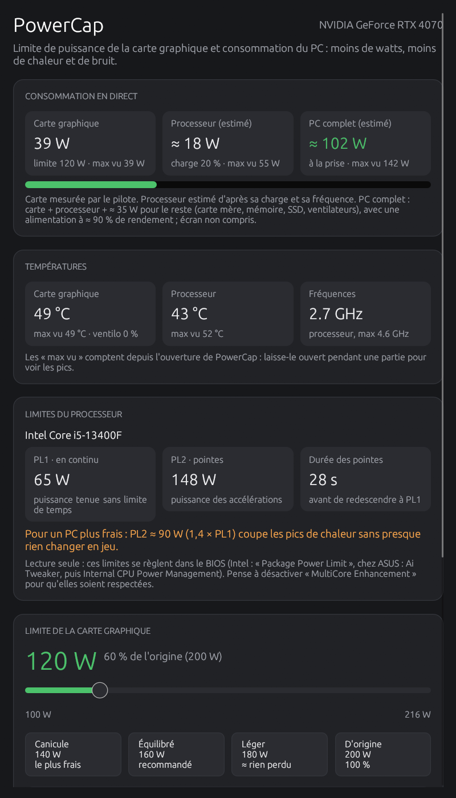

# PowerCap

**Limiter la puissance d'une carte graphique NVIDIA sous Linux, et voir ce que consomme le PC.**

Moins de watts, c'est moins de chaleur dans le boîtier et moins de bruit, surtout l'été ou dans un petit boîtier (mini-ITX). Une RTX bridée à 80 % ne perd en général que quelques pourcents d'images par seconde.



## Fonctionnalités

### Consommation en direct
- **Carte graphique** : consommation mesurée par le pilote NVIDIA.
- **Processeur (estimé)** : calculé d'après sa charge et sa fréquence, et plafonné par ses limites PL1/PL2. Le compteur d'énergie exact du processeur n'est lisible qu'en administrateur, d'où l'estimation.
- **PC complet (estimé)** : carte + processeur + mémoire + environ 30 W pour le reste (carte mère, SSD, ventilateurs), avec une alimentation à environ 90 % de rendement. C'est ce que le PC tire **à la prise**, écran non compris.
- **Mémoire vive (estimée)** : les barrettes n'ont pas de capteur de watts. L'estimation part de leur nombre, de leur type, de leur tension (1,35 V avec XMP) et de l'activité du PC : en général 3 à 12 W pour deux barrettes DDR5.
- **Températures** : carte graphique, processeur, mémoire vive (barrettes DDR5 et certaines DDR4), SSD NVMe, carte mère (chipset), et vitesse des ventilateurs. Seuls les capteurs présents sont affichés ; orange = chaud, rouge = très chaud. Les disques durs SATA ne sont pas lus, pour ne pas les réveiller.
- **Fréquences et charge** : processeur, carte graphique, et mémoire vidéo occupée.
- Pour chaque mesure, le **maximum vu** depuis l'ouverture de l'app : laisse PowerCap ouvert pendant une partie pour voir les pics.

### Mémoire vive
- **Occupation** : mémoire utilisée sur la mémoire totale, et nombre et type des barrettes (par ex. 2 × 16 Go DDR5).
- **Fréquence actuelle et maximale** en MT/s, le chiffre des boîtes (DDR5-6000 = 6000 MT/s). La vitesse maximale vient du BIOS et de la référence des barrettes (Crucial, Kingston, Corsair, G.Skill).
- **Profil XMP** : « XMP actif » si la mémoire tourne au-dessus de la norme (DDR4 3200, DDR5 5600), « XMP désactivé » si les barrettes pourraient aller plus vite que leur réglage actuel. L'app dit alors où l'activer dans le BIOS (EXPO chez AMD).
- **Température des barrettes**, quand elles ont un capteur (la plupart des DDR5).

Tout est lu sans mot de passe : la table DMI du BIOS (rendue lisible par udev) et `/proc/meminfo`.

### Limites du processeur (lecture seule)
- **PL1** (puissance en continu), **PL2** (pointes) et **durée des pointes**, lues dans `/sys/class/powercap` telles que le BIOS les a réglées.
- Conseil pour garder le PC au frais : PL2 ≈ 1,4 × PL1. Par exemple 90 W pour un i5-13400F, au lieu de 148 W.
- Ces limites se règlent dans le BIOS : chez ASUS, mode avancé (F7), puis *Ai Tweaker*, puis *Internal CPU Power Management*. Désactive aussi *MultiCore Enhancement*.
- Processeurs AMD : leurs limites (PPT) ne sont pas lisibles de cette façon. Seules la température et l'estimation sont affichées.

### Limite de la carte graphique
- **Curseur** entre le minimum et le maximum autorisés par la carte, et 4 réglages tout prêts calculés à partir de sa puissance d'origine :

  | Réglage | Part de l'origine | Exemple RTX 4070 (200 W) | Perte estimée, carte à fond |
  |---|---|---|---|
  | Canicule | 70 % | 140 W | ≈ −9 % |
  | **Équilibré (recommandé)** | **80 %** | **160 W** | **≈ −4 %** |
  | Léger | 90 % | 180 W | ≈ −1,5 % |
  | D'origine | 100 % | 200 W | 0 % |

  Avec le DLSS ou un plafond de fps, la carte tourne souvent sous la limite : la perte réelle est encore plus faible.
- **Appliquer maintenant** : la limite vaut jusqu'au prochain redémarrage.
- **Appliquer et garder au démarrage** : crée un petit service systemd qui réapplique la limite **au démarrage et après chaque sortie de veille**. Sans lui, le pilote revient à la valeur d'origine.
- **Retirer le réglage permanent** : supprime le service et remet la carte à sa puissance d'origine.
- Avec plusieurs cartes NVIDIA, un menu permet de choisir la carte. Chacune a son propre réglage.

### Overclocking de la carte (facultatif)
- Deux curseurs : **+MHz sur le processeur graphique** et **+MHz sur la mémoire vidéo**, avec 3 réglages tout prêts (D'origine, Prudent, Courant).
- **Avertissements par paliers**, en couleur : prudent, courant, élevé (beaucoup de cartes plantent), trop haut (presque sûrement instable). Les curseurs s'arrêtent un peu au-delà du palier élevé, et un réglage « trop haut » ne peut pas être gardé au démarrage.

  | Palier | Processeur graphique (RTX 30/40) | RTX 50 | Mémoire vidéo |
  |---|---|---|---|
  | Prudent | jusqu'à +100 MHz | +150 MHz | +1000 MHz |
  | Courant | +200 MHz | +300 MHz | +2000 MHz |
  | Élevé | +300 MHz | +400 MHz | +3000 MHz |

  Les valeurs sont celles du pilote NVIDIA sous Linux (NVML).
- **Essayer maintenant** : jusqu'au prochain redémarrage. **Garder au démarrage** : un service systemd le réapplique au démarrage et après la veille.
- **Avec une limite de puissance réduite** (par ex. « Équilibré »), l'overclocking ne chauffe pas plus : la carte reste plafonnée au même nombre de watts, elle en tire simplement plus d'images/s et rattrape une partie de la perte. Dans ce cas, mise surtout sur le processeur graphique, car la mémoire vidéo puise dans le même budget de watts.
- L'app explique tout pas à pas : à quoi ça sert, comment tester (« Prudent », « Essayer maintenant », 30 min de jeu, puis « Garder au démarrage »), et quoi faire en cas de plantage (redémarrer : un essai s'efface tout seul).
- Passe par NVML (la bibliothèque du pilote) : ça marche sous **Wayland**, sans `nvidia-settings` ni Coolbits. Il faut un pilote NVIDIA 510 ou plus récent, et `python3` pour l'application en administrateur.

### Mises à jour intégrées
Au lancement, au plus une fois par jour, PowerCap regarde s'il existe une nouvelle version sur GitHub et propose de l'installer. L'AppImage est téléchargée, vérifiée (empreinte SHA-256), puis remplacée, et l'app se relance. Le bouton « Rechercher les mises à jour » est en bas de la fenêtre, et la recherche automatique peut être désactivée.

## Compatibilité

- **Bazzite** (images `-nvidia`), et en général toute distribution Linux x86_64 avec le **pilote NVIDIA propriétaire** (`nvidia-smi`), **systemd** et **pkexec** (polkit) : Fedora, Nobara, CachyOS, Ubuntu, Mint, etc.
- **Cartes NVIDIA de bureau dont le pilote autorise le réglage** : en général les GeForce GTX 900 et plus récentes, et les RTX 20/30/40/50. Testé sur une RTX 4070.
- **PC portables** : la plupart des GPU NVIDIA de portables bloquent ce réglage. PowerCap le signale et affiche seulement les mesures.
- Cartes AMD / Intel : la limite de la carte n'est pas prise en charge.

## Installation

1. Télécharge `PowerCap-x.y.z-linux-x86_64.AppImage` depuis les [Releases](https://github.com/VGioM/PowerCap/releases/latest).
2. Rends-la exécutable (clic droit, Propriétés, « Exécutable », ou `chmod +x PowerCap-*.AppImage`), puis lance-la.
   Sur Bazzite, tu peux aussi l'ouvrir avec **Gear Lever** pour l'ajouter au menu des applications.

Le mot de passe administrateur est demandé (fenêtre polkit) chaque fois qu'un réglage est appliqué. La lecture des mesures n'en demande pas.

> PowerCap s'appelait **Watts** jusqu'à la version 1.0.1. Les installations de Watts se mettent à jour d'elles-mêmes vers PowerCap, et les réglages déjà faits sont repris.

## Ce que l'app modifie sur le système

Seulement quand tu cliques sur **« Appliquer et garder au démarrage »** (limite de puissance) : un fichier par carte.

```
/etc/systemd/system/powercap-gpu-<id>.service
```

```ini
[Service]
Type=oneshot
ExecStart=/usr/bin/nvidia-smi -i GPU-<uuid> -pl 160

[Install]
WantedBy=graphical.target suspend.target hibernate.target hybrid-sleep.target suspend-then-hibernate.target
```

Sur Bazzite, `/etc` est modifiable et conservé entre les mises à jour : le réglage survit donc aux mises à jour du système. Les préférences de mise à jour sont dans `~/.config/PowerCap/update.json`.

Pour tout enlever sans l'app :

```bash
sudo systemctl disable powercap-gpu-<id>.service
sudo rm /etc/systemd/system/powercap-gpu-<id>.service
sudo systemctl daemon-reload
sudo nvidia-smi -pl <puissance d'origine>   # ou redémarrer
```

Pour vérifier la limite actuelle : `nvidia-smi -q -d POWER`.

Pour l'overclocking, seulement quand tu cliques sur **« Garder au démarrage »** : `/etc/systemd/system/powercap-oc-<id>.service` par carte, et le petit script commun `/etc/powercap/gpu-oc.py` qu'il lance. « Retirer l'overclocking » supprime les deux et remet les fréquences d'origine. Sans l'app :

```bash
sudo systemctl disable powercap-oc-<id>.service
sudo rm /etc/systemd/system/powercap-oc-<id>.service /etc/powercap/gpu-oc.py
sudo systemctl daemon-reload
# puis redémarrer : les fréquences reviennent à l'origine
```

## Questions

**Est-ce que ça peut abîmer la carte ?** Non. La limite de puissance reste dans la plage que le pilote NVIDIA autorise. L'overclocking ne fait que décaler les fréquences : la carte garde sa tension maximale, sa limite de watts et sa protection contre la surchauffe, qu'aucun réglage de PowerCap ne touche. Un overclocking trop poussé fait planter le jeu ou le PC (ou baisse les performances, pour la mémoire vidéo), mais sans dégât : un redémarrage remet tout d'origine, sauf si le réglage a été gardé au démarrage.

**Mon PC plante depuis que j'ai gardé un overclocking au démarrage ?** Ouvre PowerCap et clique sur « Retirer l'overclocking », ou utilise les commandes ci-dessus.

**La limite est revenue à l'origine après un redémarrage ?** Ouvre PowerCap : s'il signale que la limite actuelle ne correspond pas au réglage permanent, clique sur « Réappliquer ». Si ça recommence, ouvre une *issue* avec la sortie de `systemctl status powercap-gpu-*.service`.

**Les watts du processeur et du PC sont-ils exacts ?** Non, ce sont des estimations, à environ 15–20 % près. Pour une mesure exacte de la consommation à la prise, il faut un wattmètre.

## Compiler

Avec Rust stable :

```bash
cargo run --release          # lancer
./build-appimage.sh          # construire dist/PowerCap-<version>-linux-x86_64.AppImage
```

`build-appimage.sh` a besoin de `mksquashfs` (squashfs-tools) et d'un runtime AppImage de type 2 (variable `APPIMAGE_RUNTIME`). Pour une AppImage compatible avec des systèmes plus anciens, compile dans un conteneur Fedora (distrobox) plutôt que sur un système très récent.

Pour publier une nouvelle version : augmente `version` dans `Cargo.toml` (1.0.2, puis 1.0.3…), construis l'AppImage, puis crée une release GitHub `vX.Y.Z` qui contient `PowerCap-X.Y.Z-linux-x86_64.AppImage`. Les installations existantes la proposeront d'elles-mêmes.

L'interface utilise [egui](https://github.com/emilk/egui). Les actions administrateur passent par `pkexec` et des scripts shell qui valident leurs arguments (watts entiers, UUID de carte, nom du service).

## Licence

[MIT](LICENSE) : tout le monde peut reprendre, modifier et améliorer PowerCap, tant que la mention de copyright est conservée.
